# Project Overview

## Uncertainty-Guided Retinal Vessel Density Estimation and Reliability Analysis Using Deep Learning

### Introduction

Retinal vessel segmentation identifies blood vessels in retinal fundus images. The quality of segmentation affects the measurement of vessel-related biomarkers, including Vessel Density (VD), Centerline Density (CD), and Fractal Dimension (FD).

However, overall segmentation metrics may not fully reflect how well a model detects thin vessels. Missed vessels can contribute to errors in these measurements. Uncertainty information may also help identify images that require further quality review.

This study investigates retinal vessel segmentation, thin-vessel recovery, biomarker estimation errors, and uncertainty-guided quality review.

### Research Questions

The study addresses two main research questions:

**RQ1:** Does adding global context to native-resolution patches improve retinal vessel segmentation and thin-vessel recovery?

**RQ2:** How are segmentation errors and uncertainty related to biomarker estimation errors, and can uncertainty help identify images for quality review?

### Research Focus

The study focuses on:

- Comparing segmentation configurations to examine the effect of native-resolution processing and global context.
- Examining thin-vessel false negatives and their relationship with biomarker estimation errors.
- Analyzing predictive and test-time augmentation (TTA)-based uncertainty signals.
- Evaluating uncertainty-guided image selection for quality review.
- Assessing the selected model on an external retinal dataset.

TTA variance and TTA Jensen–Shannon divergence (JSD) are treated as view-disagreement signals, not direct measures of epistemic uncertainty.

### Datasets

Two retinal fundus image datasets are used.

| Dataset | Purpose | Images |
|---|---|---:|
| FIVES | Model development, validation, and held-out testing | 798 |
| CHASE_DB1 | External evaluation | 28 |

The FIVES dataset contains 419 training images, 179 validation images, and 200 held-out test images.

CHASE_DB1 contains 28 images from 14 subjects. Its external test set contains 8 images from 4 subjects. The first manual annotation is used as the primary evaluation reference.

### Experimental Overview

The study follows these main stages:

1. Compare five segmentation configurations on the FIVES validation set.
2. Evaluate the selected Core-v1 model on the held-out FIVES test set.
3. Analyze thin-vessel false negatives and their relationship with VD, CD, and FD estimation errors.
4. Examine the relationships between uncertainty signals and biomarker estimation errors.
5. Evaluate uncertainty-guided image selection under fixed review budgets.
6. Assess the selected model on CHASE_DB1 without target-specific model tuning.

### Scope and Limitations

This study focuses on image-level segmentation performance, biomarker estimation errors, uncertainty analysis, and quality review.

It does not evaluate clinical diagnosis or clinical decision-making. Relationships between uncertainty and biomarker errors are interpreted as associations, not causal effects.

The CHASE_DB1 external test evaluation is limited to eight images from four subjects. Therefore, its results are reported descriptively and are not considered proof of robust generalization.

### README Guide

1. [Research Background](#1-research-background)
2. [Research Problem and Key Questions](#2-research-problem-and-key-questions)
3. [Literature Review](#3-literature-review)
4. [Research Gap](#4-research-gap)
5. [Objectives](#5-objectives)
6. [Study Design and Experimental Setup](#6-study-design-and-experimental-setup)
7. [Model Training and Model Selection](#7-model-training-and-model-selection)
8. [Results and Analysis](#8-results-and-analysis)
9. [Overall Findings](#9-overall-findings)
10. [Limitations](#10-limitations)
11. [Conclusion and Future Work](#11-conclusion-and-future-work)
12. [References](#12-references)

# 1. Research Background

Retinal vessel segmentation identifies blood vessels in fundus images and provides the basis for analyzing retinal vascular structure. The resulting vessel maps can be used to estimate biomarkers such as Vessel Density (VD), Centerline Density (CD), and Fractal Dimension (FD).

However, thin vessels are often difficult to segment because of their small size and low contrast. Missing these vessels can affect the predicted vessel structure and introduce errors in biomarker estimation. Overall segmentation metrics may not fully capture these errors.

Image resolution and contextual information are also important in vessel segmentation. Native-resolution processing can preserve fine vessel details, while global context can provide information about the wider retinal structure.

Uncertainty signals provide additional information about prediction behaviour. They may help identify images where segmentation and biomarker estimates require closer review.

This study investigates native-resolution retinal vessel segmentation with global context, thin-vessel errors, biomarker estimation, and uncertainty-guided quality review.

# 2. Research Problem and Key Questions

## Research Problem

Retinal vessel segmentation models may miss thin vessels, even when their overall segmentation performance appears satisfactory. These errors can affect the estimation of retinal biomarkers such as Vessel Density (VD), Centerline Density (CD), and Fractal Dimension (FD).

Local image patches preserve fine vessel details but provide limited information about the wider retinal structure. This raises the question of whether adding aligned global context to native-resolution patches can improve segmentation.

Furthermore, segmentation performance alone does not indicate how uncertainty relates to biomarker estimation errors or whether it can help identify images that require quality review.

## Key Research Questions

**RQ1:** Does adding global context to native-resolution patches improve retinal vessel segmentation and thin-vessel recovery?

**RQ2:** How are segmentation errors and uncertainty related to biomarker estimation errors, and can uncertainty help identify images for quality review?

# 3. Literature Review

This section reviews 14 studies published between 2020 and 2026. The selected studies cover retinal vessel segmentation, thin-vessel recovery, contextual feature learning, vascular connectivity, biomarker reliability, and uncertainty-guided quality control. Five of the reviewed studies directly use the FIVES dataset.

## 3.1 Literature Matrix

| # | Paper | Model / Exact Method | Dataset and Image Count | Reported Numerical Results | Contribution | Limitation |
|---|---|---|---|---|---|---|
| **1** | [Pyramid-Net (2021)](https://doi.org/10.3389/fmed.2021.761050) [1] | Pyramid-Net with Intra-layer Pyramid-scale Aggregation Blocks (IPABs), Pyramid Input Enhancement and Deep Pyramid Supervision. | DRIVE (40), STARE (20), CHASE-DB1 (28). | DRIVE: Sensitivity 82.38%, Accuracy 96.26%, AUC 98.32%. Thin-vessel accuracy: **91.64%**, vs. 86.91% for CE-Net. | Preserves multi-scale features for narrow-vessel detection and evaluates thin vessels separately. | Does not examine thin-vessel FN effects on VD, CD or FD errors. |
| **2** | [Multichannel DNN (2021)](https://doi.org/10.3389/fbioe.2021.697915) [2] | Three U-Net learning branches for original, thin and thick vessels, followed by probability-map fusion. Width threshold: 2.2 pixels. | DRIVE (40), STARE (20), IOSTAR (30). | DRIVE: F1 82.47%, Sensitivity 81.40%. Thin-vessel Sensitivity: **76.77%**, Specificity 97.79%. | Uses vessel-width-specific supervision to improve thin- and thick-vessel segmentation. | Thin-vessel sensitivity was lower than the comparison method's 81.70%. No downstream biomarker-error analysis. |
| **3** | [Dynamic Deep Networks (2020)](https://doi.org/10.3389/fcomp.2020.00035) [3] | Dynamic U-Net with targeted prediction using a second Mini-U-Net for ambiguous vessel regions. | DRIVE (40), STARE (20), CHASE-DB (28), AV-WIDE (30), VEVIO (16 frames and 16 mosaics); 150 images/frames/mosaics. | DRIVE: Precision 82.84%, Recall 82.35%, F1 82.59%, Accuracy 96.93%. | Uses dynamic class weighting and targeted refinement to detect faint and ambiguous vessels. | Two-stage processing requires an additional network. Remaining thin-vessel FN effects on biomarkers are not evaluated. |
| **4** | [Multi-Scale Residual Attention Network (2021)](https://doi.org/10.3390/sym13010024) [4] | MRA-UNet with Residual Attention, Bottom Reconstruction and Spatial Activation modules. | DRIVE (40), CHASE (28), STARE (20). | On DRIVE, RA+BR improved F-measure by 2.1 percentage points over MUNet. Adding SA improved sensitivity by another 4.46 points. | Uses multi-scale attention and feature reconstruction to preserve small-vessel details. | Focuses on segmentation metrics, not biomarker reliability or uncertainty-guided review. |
| **5** | [Multi-teacher Knowledge Distillation (2025)](https://doi.org/10.1007/s13755-025-00356-4) [5] | MTKD-UNet with separate original-, thin- and thick-vessel U-Net teachers and one student network. | DRIVE (40), CHASEDB1 (28), CHUAC (30), DCA1 (134); 232 images. | DRIVE: F1 80.74%; penalized variant 81.66%. CHASEDB1: F1 77.48%; penalized variant 79.95%. | Transfers vessel-specific knowledge from multiple teachers to a single student model. | Does not evaluate VD/CD/FD measurement errors or image-level uncertainty-based quality review. |
| **6** | [Retinal Fractal Dimension Repeatability (2022)](https://doi.org/10.3390/diagnostics12071769) [6] | Automated SS-OCTA segmentation and box-counting fractal dimension measurement. Repeatability assessed using ICC. | 43 eyes from 43 healthy volunteers; 3 scans per participant. | Repeatability ICC: 0.722 (superficial) and 0.828 (deep). Reproducibility ICC: 0.651 and 0.363, respectively. | Shows that retinal FD measurements are affected by acquisition and observer variability. | Uses SS-OCTA rather than colour fundus images. Does not examine segmentation-induced FD errors. |
| **7** | [Ensuring a Connected Structure for Retinal Vessels (2023)](https://openaccess.thecvf.com/content/ICCV2023W/CVAMD/papers/Dulau_Ensuring_a_Connected_Structure_for_Retinal_Vessels_Deep-Learning_Segmentation_ICCVW_2023_paper.pdf) [7] | Vessels Network Retrieval (VNR): Gap Filling and Rebranch or Remove post-processing. | DRIVE, DUALMODAL2019, HRF and LESAV; 137 images. | clDice-based predictions: mean connected components **174 → 1**, while Dice changed from 0.839 to 0.840. | Reduces vessel fragmentation while maintaining similar Dice performance. | Some reconnections may be anatomically incorrect, and genuine small components may be removed. |
| **8** | [MaskVSC (2025)](https://doi.org/10.1109/TMI.2025.3538336) [8] | TopoMask, connectivity loss and Vision GNN post-processing for masked-vessel reconstruction. | Fundus: DRIVE (40), STARE (20), RITE (40), LES-AV (21). OCTA: ROSE-1 (117), OCTA-500 (500). 2PFM: 405 images. | DRIVE U-Net Dice 75.93% → **80.30%** with MaskVSC. clDice 78.06% → 84.57%. Betti-0 error 10.3 → 1.99. | Learns to reconstruct missing vessel segments and improves structural connectivity. | Primarily designed for 2D images; the authors identify limited disease diversity and 3D extension as future work. |
| **9** | [SemTopNet (2026)](https://doi.org/10.3389/fcell.2026.1940436) [9] | Transformer semantic-topology branch, centerline refinement and Monte Carlo Dropout uncertainty supervision. | OCTA: 120 CSVD patients and 40 healthy controls. Exact segmentation image count not separately reported. Biomarker cohort: 40 CSVD and 40 healthy participants. | Dice 0.8931, clDice 0.9027, Recall 0.9293, AUC 0.9567. | Combines uncertainty-aware segmentation, topology refinement and vascular biomarker analysis. | Uses OCTA rather than RGB fundus images. Does not link thin-vessel FN rates to per-image VD/CD/FD errors or fixed-budget review. |
| **10** | [Fadugba et al. — Segmentation Benchmark (2024)](https://arxiv.org/abs/2406.14994) [10] | U-Net, FR-UNet, MA-Net, SA-UNet and W-Net; four loss functions: BCE, Dice, DiceBCE and clDice. | **FIVES (800):** 600 train, 200 test; resized to 512×512. | Best: FR-UNet + DiceBCE, Dice **90.37%**, MCC **89.80%**. U-Net + DiceBCE: Dice 90.15%. | Provides a controlled benchmark of five architectures and four loss functions on FIVES. | Image quality strongly affects segmentation results. Does not investigate biomarker measurement errors or uncertainty-guided review. |
| **11** | [Köhler et al. — Uncertainty-Guided Patch Review (2024)](https://proceedings.mlr.press/v250/kohler24a.html) [11] | Five-seed FR-UNet ensemble, pixel-wise entropy and top-ranked non-overlapping 81×81 patches for manual review. | **FIVES (800):** 600 train, 120 validation, 200 test; resized to 512×512. | Initial test Dice: **0.887 ± 0.094**. Five-patch review increased median Dice by over 0.02. Average 3.2 patches/image reached a quality standard near 0.90. DSC estimator MAE: 0.02. | Uses uncertainty maps to select local segmentation regions for manual correction. | Assumes reviewed patches receive perfect correction. Focuses on Dice improvement rather than biomarker-specific image-level review. |
| **12** | [Vargas Quiros et al. — VascX Models (2025)](https://doi.org/10.1167/tvst.14.7.19) [12] | Deep U-Net ensembles for vessel, artery-vein and optic-disc segmentation and fovea localization. | **FIVES (800)** included in model evaluation; development also uses more than 15 annotated datasets and Dutch study images. Feature agreement evaluated separately on 215 Rotterdam fundus images. | FIVES Dice: VascX 0.832, AutoMorph 0.824, LittleWNet 0.756. On Rotterdam, 14/24 features had significantly lower MAE than AutoMorph and 23/24 than LittleWNet. | Connects segmentation outputs with quantitative vascular-feature accuracy. | Feature MAE results come from Rotterdam, not FIVES. Does not examine our specific thin-FN versus VD/CD/FD error relationship. |
| **13** | [Wang et al. — LFU-Net (2026)](https://doi.org/10.1038/s41598-026-50642-8) [13] | MobileNetV2, Frequency-Aware Encoder, hierarchical FreqTokenLoRA and Recursive Residual Attention Fusion. | **FIVES (800):** 600 train, independent 200 test. | Dice **85.00%**, IoU 73.90%, Sensitivity 81.90%, Faint Vessel Dice **77.50%**. AutoMorph Faint Vessel Dice: 66.50%. | Directly evaluates faint-vessel recovery using a separate width-based metric. | Faint-vessel evaluation uses a diameter-below-2-pixel definition. Does not evaluate downstream VD/CD/FD errors. |
| **14** | [Shu et al. — Morphology-Aware Reconstruction Distillation (2026)](https://doi.org/10.3389/fcell.2026.1825518) [14] | MRD with Hierarchical Structure Fusion (HSF), Fuse Cross Stage Feature, Selective Fusion and Residual Gating. Uses decoder-focused knowledge distillation and Hierarchical Context Loss. | **FIVES (800)** at 2048×2048. Figure 8 describes 200 test cases; the exact train/test split is not specified in the dataset description. Also uses DRIVE and ROSE. | Dice **90.01%**, mIoU 82.84%, Hausdorff Distance 5.95, parameters 8.14M. MambaUNet Dice: 90.47%. | Preserves fine-vessel morphology and topology through lightweight decoder distillation. | Designed for U-shaped architectures. The authors identify cross-centre variability, 3D scaling and limited gains on simpler segmentation tasks as remaining issues. 

# 4. Research Gap

The reviewed studies show that retinal vessel segmentation, thin-vessel recovery, topology preservation, biomarker analysis and uncertainty-guided review have already received research attention. Recent FIVES-based work has also evaluated segmentation models, faint-vessel performance and uncertainty-based patch correction.

However, the reviewed FIVES studies do not establish the full relationship between **per-image thin-vessel false negatives and errors in Vessel Density (VD), Centerline Density (CD), and Fractal Dimension (FD)**. They also do not jointly evaluate whether predictive uncertainty and test-time augmentation disagreement can identify images with larger biomarker errors under fixed image-review budgets.

This study addresses these questions through a controlled segmentation comparison, thin-vessel error analysis, biomarker reliability assessment and uncertainty-guided image-level quality review using FIVES.
# 5. Objectives

### Objectives

1. Compare native-resolution segmentation with and without global context using a parameter-matched native-only control.
2. Measure thin-vessel false negatives and their relationship with VD, CD, and FD estimation errors.
3. Evaluate predictive entropy and six-view TTA disagreement for identifying high-error images under fixed review budgets.
4. Evaluate the selected model on the held-out FIVES test set and the external CHASE_DB1 dataset.

## 6. Study Design and Experimental Setup

### 6.1 Study Design

FIVES was used for model development and internal evaluation. Five segmentation configurations were compared on the validation set. The selected proposed model was then used for thin-vessel, biomarker, and uncertainty analyses. CHASE_DB1 was used for a limited external evaluation.

### 6.2 Dataset and Input Preparation

| Dataset | Images | Use |
|---|---:|---|
| FIVES [15] | 798 | 419 training, 179 validation, 200 test |
| CHASE_DB1 [16] | 8 selected images from 4 subjects | External evaluation |

- Original FIVES image size: 2048 × 2048 RGB.
- RGB normalization: [0, 1].
- Native patch size: 512 × 512; stride: 256; 49 patches per image.
- Total patches: 20,531 training and 8,771 validation.
- Proposed-model global view: 384 × 384.
- M0 input: resized full image at 512 × 512.

### 6.3 Segmentation Configurations

| Model | Configuration | Parameters | Threshold |
|---|---|---:|---:|
| M0 | Resized full-image U-Net [17] | 117,361 | 0.65 |
| M1 | Native-resolution patch U-Net | 117,361 | 0.40 |
| M2 | Native patches with global context | 634,113 | 0.35 |
| Proposed Model | Multi-scale native and global context | 2,450,849 | 0.49 |
| Capacity-control | Parameter-matched native-only model | 2,449,585 | 0.47 |

The proposed model combines native features with coordinate-aligned global features through gated fusion. The capacity-control model has a similar parameter count but does not use a global-context branch.

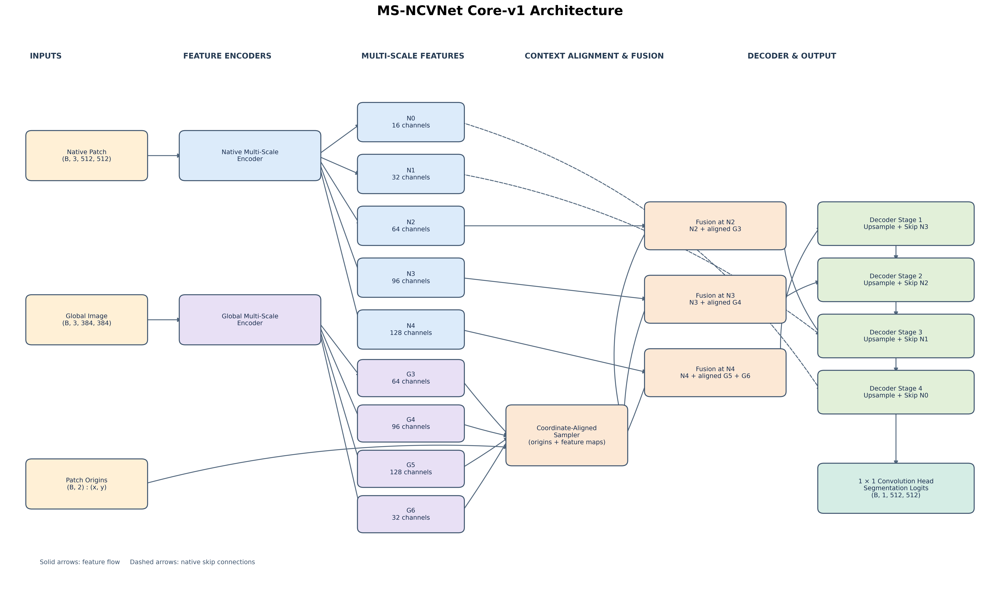

*Figure 1. MS-NCVNet Core-v1 architecture, including multi-scale encoding, coordinate-aligned fusion, and decoding.*

### 6.4 Training Setup

M0, M1, and M2 were trained for up to 20 epochs. The proposed model and capacity-control used a maximum of 70 epochs with early stopping.

| Setting | Proposed Model |
|---|---|
| Seed | 42 |
| Batch size | 16 |
| Optimizer | AdamW |
| Learning rate | 0.001 |
| Weight decay | 0.01 |
| Scheduler | CosineAnnealingLR (minimum LR: 0.00001) |
| Loss | 0.5 BCE + 0.5 soft Dice |
| Mixed precision | FP16 |
| Early stopping | 15 epochs without improvement |
| GPU | NVIDIA Tesla T4 |

- Brightness augmentation: alpha 0.9–1.1 and beta -0.05–0.05.
- The same sampled adjustment was applied to native and global views.
- Best proposed-model checkpoint: epoch 20; training stopped after epoch 35.

### 6.5 Prediction and Segmentation Evaluation

Patch probabilities were mapped to their original coordinates and combined by uniform overlap averaging. The fixed threshold was applied after full-image reconstruction. The proposed-model threshold (0.49) was selected on the validation set by maximizing pooled micro Dice.

Segmentation was evaluated using Dice, ROC-AUC, clDice [18], and thin-vessel recall. The validation set was used for configuration comparison; the held-out FIVES test set was reserved for final evaluation.

### 6.6 Thin-Vessel, Biomarker, and Uncertainty Analysis

- **Thin vessels:** Reference-mask pixels with an estimated vessel diameter of 4 pixels or less were classified as thin vessels. Diameter was propagated from the nearest skeleton using the Euclidean distance transform.
- **Biomarkers:** Vessel density (VD), centerline density (CD), and fractal dimension (FD) were calculated from reference and predicted masks. The FOV was defined as `max(R, G, B) > 7.65`. FD used box sizes of 2, 4, 8, 16, 32, 64, and 128 pixels.
- **Uncertainty signals:** Predictive entropy, entropy of the mean prediction, six-view TTA variance, and six-view TTA JSD were examined. The TTA views were identity, horizontal flip, vertical flip, and rotations of 90°, 180°, and 270°. Variance and JSD represent prediction disagreement across transformed views.
- **Image review:** Images were ranked by uncertainty. Review budgets of 9, 18, and 36 images were compared with random selection using 10,000 draws without replacement.

### 6.7 External Evaluation

The proposed model was evaluated on eight CHASE_DB1 images from four subjects. The first manual annotation was used as the reference mask. This provides a limited external evaluation.

## 7. Model Training and Model Selection

### 7.1 Training Runs

All models used the same FIVES training and validation splits. The five-model comparison used the seed-42 checkpoint from each configuration.

| Model | Seeds | Maximum Epochs | Batch Size | Best Epoch (Seed 42) |
|---|---|---:|---:|---:|
| M0 | 42, 43 | 20 | 8 | 19 |
| M1 | 42, 43 | 20 | 16 | 15 |
| M2 | 42, 43 | 20 | 16 | 19 |
| Proposed Model | 42 | 70 | 16 | 20 |
| Capacity-control | 42 | 70 | 16 | 26 |

The Proposed Model stopped at epoch 35, while the capacity-control model stopped at epoch 41 through early stopping.

### 7.2 Training Configuration

All five configurations used AdamW with an initial learning rate of 0.001 and weight decay of 0.01. The training loss combined binary cross-entropy and soft Dice loss with equal weights.

| Setting | M0 | M1 and M2 | Proposed Model and Capacity-control |
|---|---|---|---|
| Input | Resized full image | Native patches | Native patches |
| Batch size | 8 | 16 | 16 |
| Dice calculation | Per image | Per patch | Per patch |
| Mixed precision | FP16 | FP16 | FP16 |

The Proposed Model and capacity-control also used CosineAnnealingLR with a minimum learning rate of 0.00001. Both used early stopping with a patience of 15 epochs.

Brightness augmentation used alpha values from 0.9 to 1.1 and beta values from -0.05 to 0.05. For the Proposed Model, the same adjustment was applied to the native patch and global view.

### 7.3 Checkpoint Selection

At each epoch, predictions were reconstructed on the original image grid. The checkpoint with the lowest mean reconstructed-image BCE/Dice validation loss was selected. Ties were resolved by keeping the earlier checkpoint.

The held-out test set was not used for checkpoint selection.

### 7.4 Threshold Selection

Threshold selection was performed separately using validation data. The fixed thresholds are reported in Section 6.3.

- **Proposed Model:** Selected using a validation sweep from 0.01 to 0.99, with pooled micro Dice as the primary criterion.

The Proposed Model threshold protocol was amended after an earlier sweep. It was not a preregistered rule. No threshold was adjusted using test results.

# 8. Results and Analysis

This section reports the results in the order of the research workflow. FIVES validation results are used for configuration comparison and review-policy development. The held-out FIVES test set provides the primary internal evaluation. CHASE_DB1 is used for a limited external evaluation. These results are reported separately.

## 8.1 Experimental Overview

FIVES contains 798 images. The dataset was divided into 419 training images, 179 validation images, and 200 held-out test images. Five segmentation configurations were compared on the validation set. The selected Proposed Model (internal implementation name: Core-v1) was then evaluated on the held-out test set.

CHASE_DB1 contains 28 images from 14 subjects. Its 20-image training partition was not used to train the model. The external test contains eight images from four subjects. The first manual annotation was used as the primary reference.

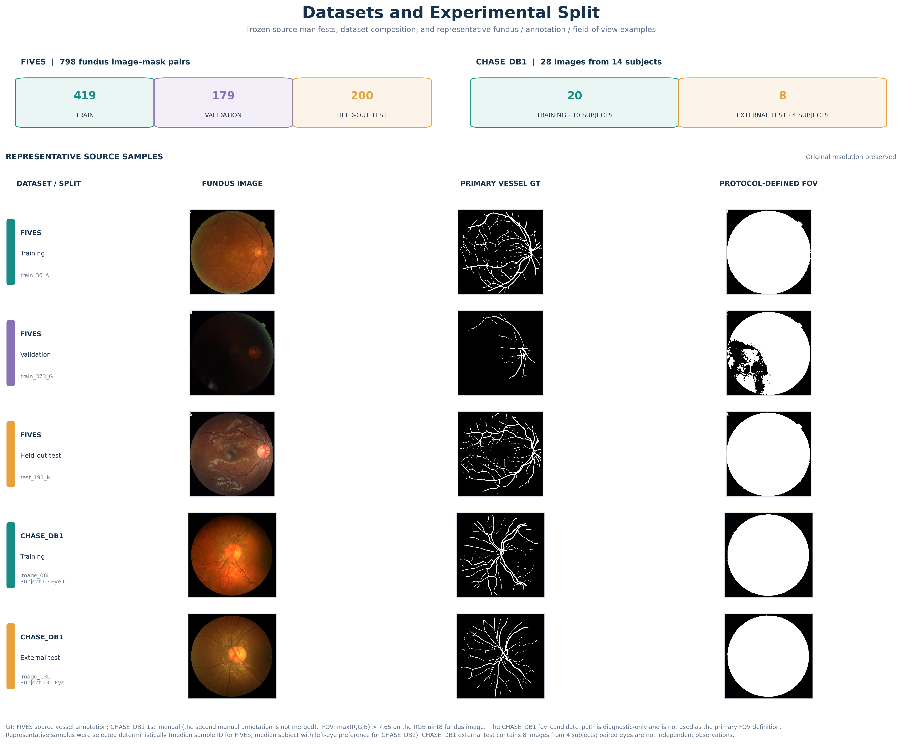

*Figure 02. FIVES development and test partitions, and the CHASE_DB1 external evaluation split.*

## 8.2 Training Behaviour and Model Selection

The Proposed Model was trained using seed 42. The best checkpoint was selected at epoch 20, achieving a mean reconstructed-image validation loss of 0.059198. Training continued until epoch 35, when early stopping was triggered.

Figure 04(a) presents the training and validation loss curves together. After epoch 20, training loss continued to decrease, while validation loss showed no sustained improvement. This divergence indicates an overfitting tendency during the later training epochs and supports selecting the epoch-20 checkpoint.

Figure 04(b) shows the two loss trends separately for clearer inspection. Training loss was calculated over training patches, whereas validation loss was calculated on reconstructed full images. Therefore, their absolute values should not be directly compared as equivalent measurements.

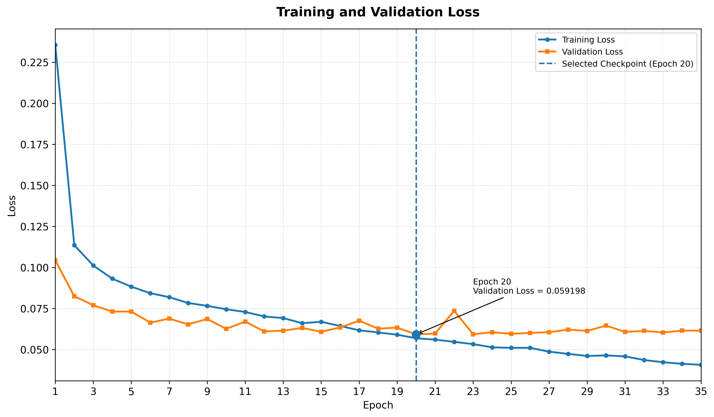

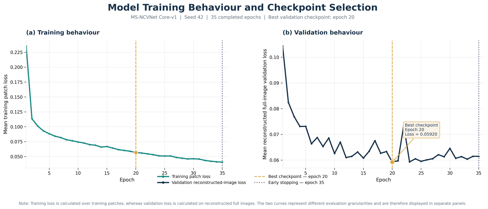

*Figure 04. Training behaviour, showing the combined loss curves and their separate trends. The best checkpoint was selected at epoch 20, followed by early stopping at epoch 35.*

## 8.3 Segmentation Configuration Comparison (RQ1)

The five configurations were compared on the 179-image FIVES validation set. The table reports mean image-level thin-vessel recall and the mean absolute errors (MAE) for the three biomarkers.

| Configuration | Threshold | Thin-vessel recall | VD MAE | CD MAE | FD MAE |
|---|---:|---:|---:|---:|---:|
| M0 | 0.65 | 0.240589 | 0.012213 | 0.000823 | 0.045448 |
| M1 | 0.40 | 0.360818 | 0.005570 | 0.000452 | 0.052219 |
| M2 | 0.35 | 0.429126 | 0.003919 | **0.000367** | 0.038587 |
| Proposed Model | 0.49 | **0.495328** | **0.003073** | 0.000471 | **0.017908** |
| Capacity-control | 0.47 | 0.476057 | 0.004189 | 0.000487 | 0.025188 |

The Proposed Model achieved the highest mean thin-vessel recall and the lowest VD and FD MAE. M2 achieved the lowest CD MAE. The result therefore varies by metric. The Proposed Model should not be described as the best configuration on every measure.

The qualitative comparison includes one case where the Proposed Model performed better, one typical case, and one case where a competing configuration performed better. These examples illustrate image-level variation. They do not represent the frequency of each outcome across the full validation set.

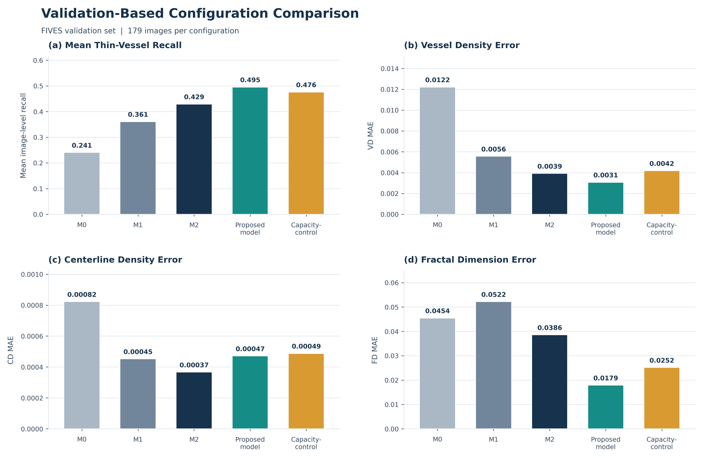

*Figure 05. Thin-vessel recall and biomarker MAE across the five configurations on FIVES validation.*

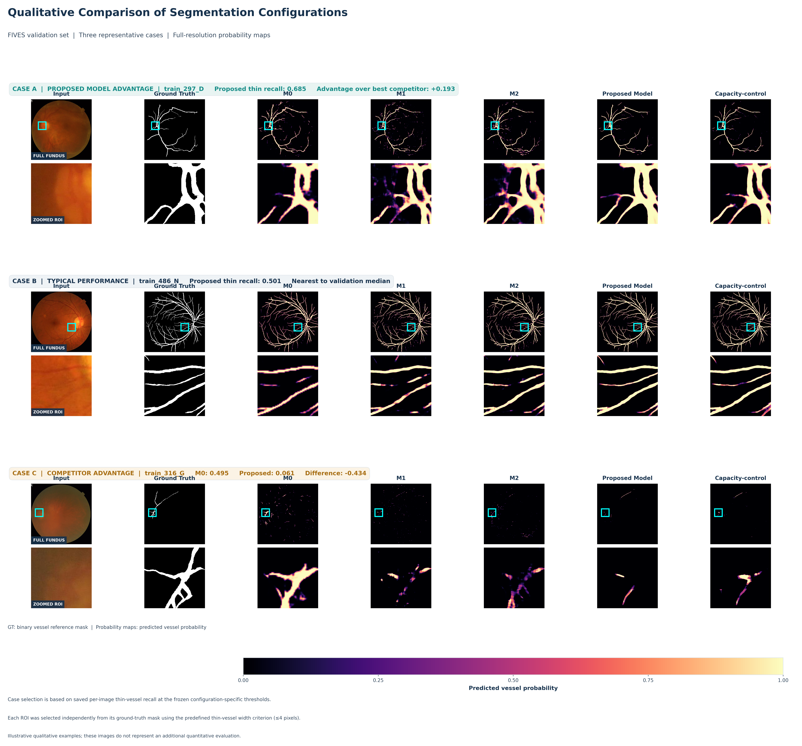

*Figure 06. Three representative validation cases showing a Proposed Model advantage, typical performance, and a competitor advantage.*

The configurations use different architectures, parameter counts, and frozen thresholds. This comparison evaluates complete operating configurations. It does not isolate the causal effect of global context independently of the other design differences.

## 8.4 Final Segmentation Performance

The selected Proposed Model achieved the segmentation results shown in Table 8. The model was evaluated using the fixed threshold of 0.49. The full-image evaluation used the complete image canvas without field-of-view clipping.

| Metric | Image mean | Pooled/micro |
|---|---:|---:|
| Dice | 0.924268 | 0.939285 |
| Precision | 0.938817 | 0.946943 |
| Sensitivity | 0.915434 | 0.931750 |
| ROC-AUC* | 0.990784 | 0.994744 |
| clDice | 0.923031 | 0.937156 |

Image-mean values represent the average of the per-image metrics, whereas pooled/micro values are calculated over the combined pixel counts. The two aggregation methods provide complementary views of segmentation performance.

*ROC-AUC is a 4,096-bin histogram approximation. It is not an exact continuous-score AUC.*

## 8.5 Thin-Vessel Errors and Biomarker Reliability (RQ2)

Thin vessels were defined as ground-truth vessel regions with an estimated width of 4 pixels or less. The thin-vessel false-negative (FN) rate was calculated as the number of missed thin-vessel pixels divided by the total number of thin ground-truth pixels. The thin-vessel mask was constructed before field-of-view restriction.

Spearman correlation was used to examine the relationship between thin-vessel FN rate and absolute biomarker error. The saved analyses report paired image-level bootstrap 95% confidence intervals and Benjamini-Hochberg (BH) adjusted q-values.

| Split | Biomarker | Spearman ρ | Bootstrap 95% CI | BH q-value | Highest/lowest FN-quartile MAE ratio |
|---|---|---:|---:|---:|---:|
| Validation (n=179) | VD | 0.155280 | [-0.003650, 0.306000] | 0.037940 | 1.80× |
| Validation (n=179) | CD | 0.662130 | [0.564170, 0.742280] | <0.00001 | 4.06× |
| Validation (n=179) | FD | 0.435540 | [0.305360, 0.554090] | <0.00001 | 2.39× |
| Test (n=200) | VD | 0.245463 | [0.098534, 0.377239] | 4.594165e-04 | 2.10× |
| Test (n=200) | CD | 0.551963 | [0.439399, 0.659782] | 7.257549e-17 | 2.65× |
| Test (n=200) | FD | 0.344599 | [0.209307, 0.457421] | 8.747227e-07 | 2.37× |

CD showed the strongest association with thin-vessel FN rate in both splits. On the held-out test set, all three associations remained significant after BH correction. The highest-FN quartile also had larger MAE than the lowest-FN quartile for all three biomarkers.

The validation VD result requires care. Its BH q-value was below 0.05, but its bootstrap confidence interval slightly crossed zero. This result should not be interpreted as strong evidence on its own.

Figure 08 illustrates a test image selected from the 50 images with the highest thin-vessel FN rates. The selected image had a thin-vessel FN rate of 0.644309, with 4,534 missed pixels among 7,037 thin ground-truth pixels. Figure 09 shows the test-set associations and the quartile-based MAE comparison.

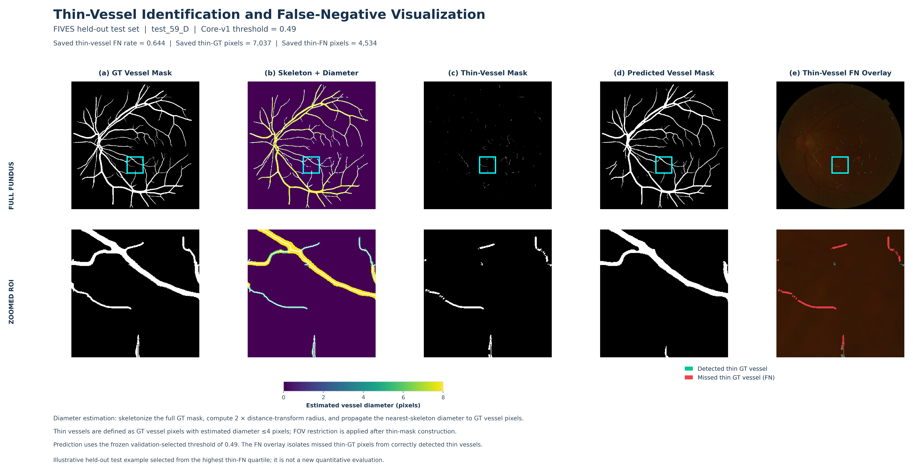

*Figure 08. Ground-truth thin-vessel identification and missed thin-vessel regions for a representative FIVES test image.*

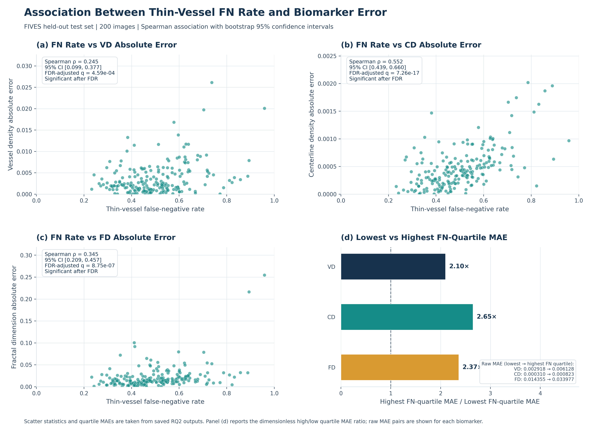

*Figure 09. Associations between thin-vessel FN rate and absolute VD, CD, and FD errors, with the highest-versus-lowest FN-quartile comparison.*

## 8.6 Uncertainty and Biomarker Reliability (RQ2)

Four image-level signals were examined: Core-v1 predictive entropy, six-view TTA variance, six-view TTA JSD, and entropy of the mean TTA probability. Their relationships with absolute VD, CD, and FD errors were measured using Spearman correlation.

TTA variance and TTA JSD measure disagreement across transformed views. They are not direct or calibrated measures of epistemic uncertainty. The table reports Spearman ρ as validation/test pairs.

| Biomarker error | Core entropy | TTA variance | TTA JSD | Entropy of mean |
|---|---:|---:|---:|---:|
| VD | 0.107 / 0.178 | 0.214 / 0.341 | 0.223 / 0.344 | 0.186 / 0.253 |
| CD | 0.082 / 0.130 | 0.249 / 0.171 | 0.246 / 0.172 | 0.200 / 0.172 |
| FD | -0.014 / -0.071 | 0.535 / 0.394 | 0.554 / 0.389 | 0.328 / 0.110 |

*Each cell shows validation ρ / test ρ. Validation n=179; test n=200.*

TTA variance and TTA JSD were positively associated with all three biomarker errors in both splits. Their strongest associations were with FD error. Core entropy was not significant for any validation outcome and was not significant for CD or FD on the test set. Entropy of the mean was not significant for FD on the test set. The remaining reported associations were significant after BH correction within their corresponding 12-test split.

The validation and test estimates are presented descriptively. No formal hypothesis test was performed to compare the two splits. Figure 10 shows the predictive and TTA signals for a representative test image. Figure 11 presents the correlations and paired image-level bootstrap 95% confidence intervals.

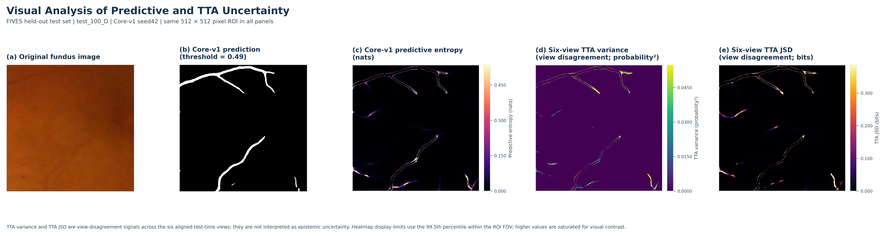

*Figure 10. Predictive entropy, six-view TTA variance, and six-view TTA JSD for a representative FIVES test image.*

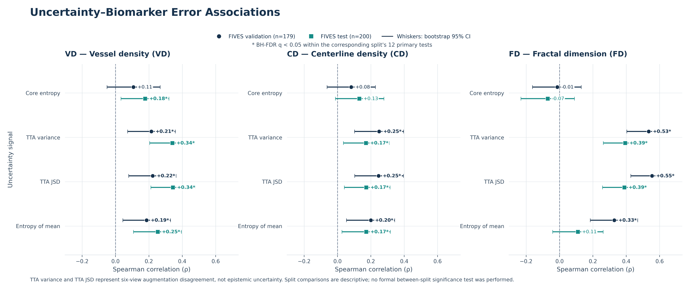

*Figure 11. Validation and test Spearman correlations with paired image-level bootstrap 95% confidence intervals. Asterisks indicate BH-adjusted q < 0.05 within the corresponding split.*

## 8.7 Uncertainty-Guided Quality Review (RQ2)

Images were ranked using four uncertainty signals. The top 5%, 10%, and 20% were selected for review. This corresponded to 9, 18, and 36 images on validation, and 10, 20, and 40 images on the test set. High-error cases were defined as the top 20% of images by absolute error for each biomarker. The saved random baseline used 10,000 uniform samples without replacement with seed 42. BH correction was applied across the 36 method, outcome, and budget comparisons within each split.

At the 20% review budget, the TTA JSD ranking produced the following high-error recall:

| Split | Biomarker | High-error cases captured | High-error recall | BH q-value | Better than random after FDR? |
|---|---|---:|---:|---:|---|
| Validation | VD | 15/36 | 0.416667 | 0.003600 | Yes |
| Validation | CD | 11/36 | 0.305556 | 0.144671 | No |
| Validation | FD | 20/36 | 0.555556 | 0.000900 | Yes |
| Test | VD | 21/40 | 0.525000 | 0.000600 | Yes |
| Test | CD | 13/40 | 0.325000 | 0.043346 | Yes |
| Test | FD | 14/40 | 0.350000 | 0.017278 | Yes |

The fixed-budget ranking and the frozen cutoff policy are separate evaluations. The ranking selects a fixed number of images. The policy applies a validation-derived numeric JSD cutoff of `0.0083761754351451` without changing it on the test set. Under the saved test policy, VD and FD each sent 163 of 200 images (81.5%) to manual review. Each policy captured 37 of 40 high-error cases (recall 0.925; precision 0.227). The CD policy sent all 200 images for manual review and captured all 40 high-error cases (recall 1.000; precision 0.200).

The policy therefore had a high manual-review burden. These results do not show workload reduction. The validation protocol does not specify the JSD logarithm base or unit, while the test TTA protocol records JSD in bits. The numeric cutoff is reported without assigning a unit because this protocol detail is not fully consistent in the saved records.

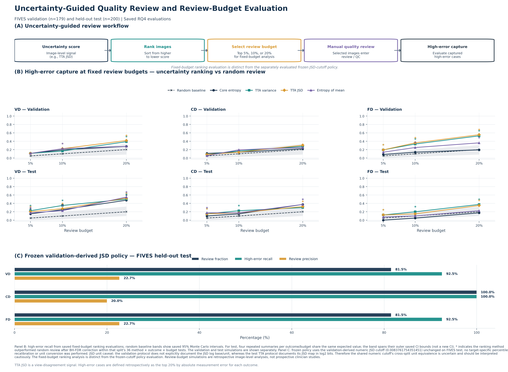

*Figure 12. Review-budget ranking results for four uncertainty signals and the frozen validation-derived policy evaluated on the FIVES test set. The test random-baseline band is an envelope of saved intervals, not a newly calculated confidence interval.*

## 8.8 External Evaluation on CHASE_DB1

The Proposed Model was evaluated on the eight-image CHASE_DB1 test set using the first manual annotation and the provided evaluation field-of-view mask. The threshold remained 0.49, as selected on FIVES validation. No CHASE-specific model training or threshold tuning was performed.

| Metric | Image-level summary | Pooled/micro |
|---|---:|---:|
| Dice | Mean: 0.738710; median: 0.741809 | 0.738769 |
| Precision | Not reported in the saved summary | 0.626575 |
| Sensitivity | Not reported in the saved summary | 0.899904 |
| Specificity | Not reported in the saved summary | 0.964135 |
| Accuracy | Not reported in the saved summary | 0.960109 |
| ROC-AUC | Mean: 0.973705 | 0.973713 |
| clDice | Mean: 0.815358 | 0.815641 |

The external thin-vessel analysis did not show a significant association after BH correction. The saved Spearman correlations were 0.380952 for VD, 0.000000 for CD, and 0.142857 for FD; all adjusted q-values were 1. The quartile groups contained only two images each and are therefore unstable.

None of the 12 uncertainty–biomarker associations on the CHASE_DB1 test set remained significant after BH correction. Subject-level summaries based on four subjects are descriptive only.

The frozen FIVES review policy was also applied without recalibration. For VD, 7 of 8 images were sent to manual review and 1 of 2 high-error cases was captured. For CD, all 8 images were reviewed and 2 of 2 high-error cases were captured. For FD, 7 of 8 images were reviewed and 2 of 2 high-error cases were captured. No external policy comparison beat random selection after FDR correction. These counts are descriptive and do not establish policy effectiveness on external data.

CHASE_DB1 results are limited to eight images from four subjects. They do not establish robust generalization, clinical utility, or clinical readiness.

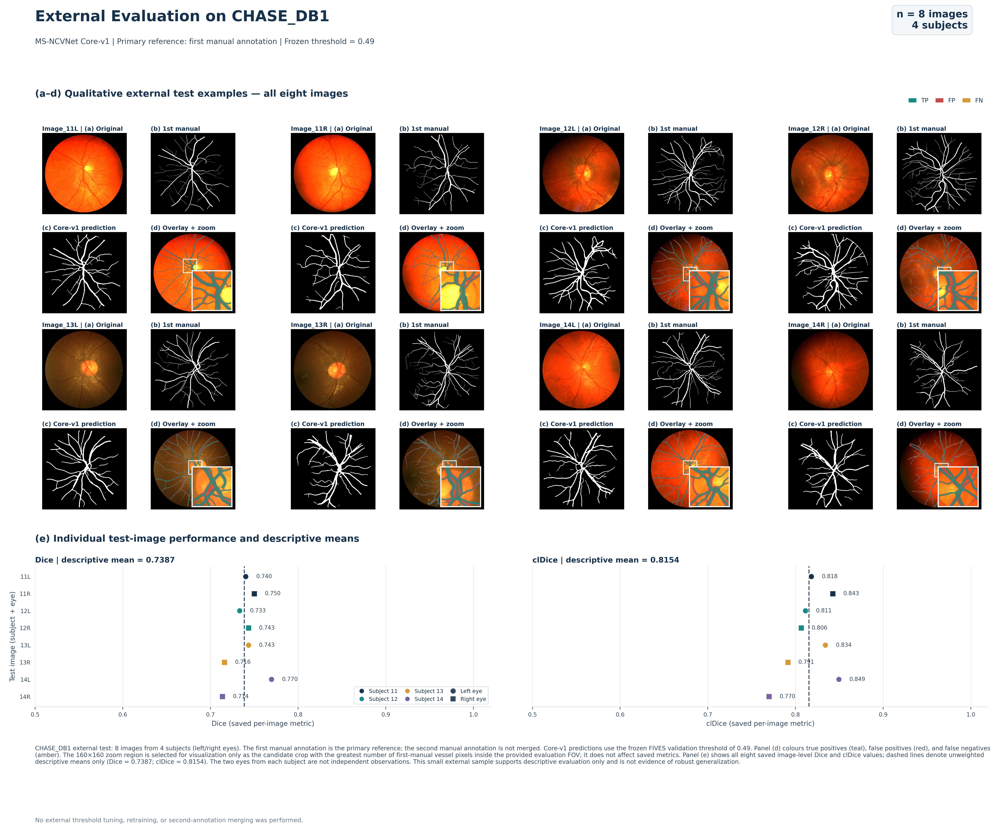

*Figure 13. Per-image segmentation examples and summary results for the eight-image CHASE_DB1 external test set.*

<!-- Evidence map: 8.1 figure02_representative_samples.csv and figure02_generation_protocol.json; 8.2 figure04_training_history_plotted.csv and figure04_generation_protocol.json; 8.3 rq1_configuration_summary.csv, figure05_plotted_validation_metrics.csv, figure06_three_case_selection.csv and figure06_generation_metadata.json; 8.4 core_probability_maps/core_v1_probabilities.npy (179 validation images) and the revised-threshold full-image validation summary (threshold 0.49; full 2048×2048 canvas); 8.5 rq2_test_thin_fn_measurement_correlations.csv, rq2_test_thin_fn_quartile_summary.csv, figure08_test_case_selection.csv and figure09_saved_correlation_and_quartile_statistics.csv; 8.6 rq3_test_primary_uncertainty_error_correlations.csv, rq3_test_analysis_protocol.json and figure11_validation_vs_test_correlation_data_updated.csv; 8.7 figure12_review_budget_plot_data.csv, figure12_frozen_policy_plot_data.csv and figure12_generation_metadata.json; 8.8 figure13_chase_test_per_image_dice_cldice_and_roi.csv and CHASE_DB1_CORE_V1_SPLIT_SUMMARY.csv. -->

## 9. Overall Findings

This study addressed two research questions on retinal vessel segmentation and biomarker reliability.

**RQ1: Effect of global context on segmentation**

The Proposed Model achieved the highest thin-vessel recall and the lowest VD and FD errors among the five configurations in the main validation comparison. Its thin-vessel recall was 0.495328, with VD MAE of 0.003073 and FD MAE of 0.017908. M2 achieved the lowest CD MAE (0.000367), while the Proposed Model achieved 0.000471.

These results show that the Proposed Model provides a strong overall balance, particularly for thin-vessel recovery, VD, and FD. However, it did not achieve the best result for every measure. The comparison evaluates complete model configurations and does not isolate the effect of global context from all other architectural differences.

**RQ2: Thin-vessel errors, biomarker reliability, and quality review**

Thin-vessel false negatives were associated with errors in all three biomarkers. The strongest relationship was found for CD, followed by FD. This pattern appeared in both FIVES validation and held-out test results.

| Biomarker | Validation Spearman ρ | Test Spearman ρ |
|---|---:|---:|
| VD | 0.155 | 0.245 |
| CD | 0.662 | 0.552 |
| FD | 0.436 | 0.345 |

The validation VD result requires caution because its bootstrap confidence interval crossed zero, although its BH-adjusted q-value was below 0.05. The other reported associations provide clearer evidence of a positive relationship.

The highest thin-FN quartile also had larger measurement errors than the lowest quartile. The high-to-low MAE ratios were 1.80× for VD, 4.06× for CD, and 2.39× for FD in validation. In the held-out test results, the corresponding ratios were 2.10×, 2.65×, and 2.37×.

Uncertainty analysis showed that TTA variance and TTA JSD were useful signals for identifying some images with larger biomarker errors. However, their usefulness depended on the biomarker. The review experiments also showed that uncertainty-guided selection did not perform equally well for VD, CD, and FD. In particular, the frozen policy required manual review of all images for CD and a large proportion of images for VD and FD.

Overall, the findings support the link between thin-vessel segmentation errors and biomarker measurement errors. They also show that uncertainty can support image-level quality review, but it cannot replace direct measurement checks or human review.

## 10. Limitations

This study has several limitations.

- **Dataset coverage:** The main experiments used FIVES. Results from one primary dataset may not represent the full range of retinal images and imaging conditions.

- **External evaluation size:** The CHASE_DB1 external test included only 8 images from 4 subjects. Its results are descriptive and do not establish robust generalization to other datasets.

- **Reference annotations:** Segmentation and biomarker measurements depend on the available vessel annotations. Differences between manual annotations and actual vessel boundaries may affect the measured errors.

- **Biomarker scope:** The study focused on VD, CD, and FD. These are image-based measurements and do not provide physical vessel dimensions. The images were not calibrated to micrometres, and artery–vein separation was not performed.

- **Uncertainty interpretation:** TTA variance and TTA JSD measure disagreement across transformed views. They are not direct or calibrated estimates of epistemic uncertainty. Their relationship with biomarker errors does not establish causation.

- **Quality-review evaluation:** The review strategy was evaluated through retrospective image-level selection and simulated random comparisons. No clinical reader study or real-world review workflow was conducted. The frozen policy also produced a high review burden, especially for CD.

These limitations mean that the results should be understood as an image-level study of segmentation and measurement reliability, not as evidence of clinical readiness.

## 11. Conclusion and Future Work

This study examined retinal vessel segmentation beyond pixel-level performance. It compared five segmentation configurations and investigated how thin-vessel false negatives relate to VD, CD, and FD measurement errors.

The Proposed Model achieved the strongest results for thin-vessel recall, VD error, and FD error in the main validation comparison, while M2 performed best for CD error. The analysis also showed that higher thin-vessel FN rates were associated with larger biomarker errors, particularly for CD and FD.

Uncertainty-guided review identified some high-error images, but its performance varied across biomarkers. The external CHASE_DB1 evaluation provided an initial assessment under a different dataset, but its small sample limits the conclusions.

Future work should focus on the following areas:

1. **Broader external evaluation:** Test the model on larger retinal datasets with more subjects and varied imaging conditions.
2. **Improved thin-vessel recovery:** Study methods that reduce thin-vessel false negatives without increasing false-positive predictions.
3. **Better uncertainty assessment:** Compare view-disagreement signals with calibrated uncertainty methods and examine their reliability across datasets.
4. **Practical quality review:** Evaluate the review strategy with human graders and measure its effect on review time, agreement, and measurement reliability.

The main contribution of this work is an evaluation framework that connects retinal vessel segmentation errors with downstream biomarker reliability and image-level quality review.

# 12. References

The references below support the studies discussed in the literature review and the datasets, architectures, and evaluation methods used in this project. Journal and conference papers are linked through their publisher or DOI records. Preprints are identified as preprints.

## 12.1 Research Papers

[1] J. Zhang, Y. Zhang, H. Qiu, W. Xie, Z. Yao, H. Yuan, Q. Jia, T. Wang, Y. Shi, M. Huang, J. Zhuang, and X. Xu, “Pyramid-Net: Intra-layer Pyramid-Scale Feature Aggregation Network for Retinal Vessel Segmentation,” *Frontiers in Medicine*, vol. 8, Art. no. 761050, 2021. [https://doi.org/10.3389/fmed.2021.761050](https://doi.org/10.3389/fmed.2021.761050)

[2] J. Ding, Z. Zhang, J. Tang, and F. Guo, “A Multichannel Deep Neural Network for Retina Vessel Segmentation via a Fusion Mechanism,” *Frontiers in Bioengineering and Biotechnology*, vol. 9, Art. no. 697915, 2021. [https://doi.org/10.3389/fbioe.2021.697915](https://doi.org/10.3389/fbioe.2021.697915)

[3] A. Khanal and R. Estrada, “Dynamic Deep Networks for Retinal Vessel Segmentation,” *Frontiers in Computer Science*, vol. 2, Art. no. 35, 2020. [https://doi.org/10.3389/fcomp.2020.00035](https://doi.org/10.3389/fcomp.2020.00035)

[4] Y. Jiang, H. Yao, C. Wu, and W. Liu, “A Multi-Scale Residual Attention Network for Retinal Vessel Segmentation,” *Symmetry*, vol. 13, no. 1, Art. no. 24, 2021. [https://doi.org/10.3390/sym13010024](https://doi.org/10.3390/sym13010024)

[5] A. Eid, M. Aydin, and Z. Kuş, “Multi-teacher based knowledge distillation for retinal vessel segmentation,” *Health Information Science and Systems*, vol. 13, Art. no. 39, 2025. [https://doi.org/10.1007/s13755-025-00356-4](https://doi.org/10.1007/s13755-025-00356-4)

[6] “Repeatability and Reproducibility of Retinal Fractal Dimension Measured with Swept-Source Optical Coherence Tomography Angiography in Healthy Eyes: A Proof-of-Concept Study,” *Diagnostics*, vol. 12, no. 7, Art. no. 1769, 2022. [https://doi.org/10.3390/diagnostics12071769](https://doi.org/10.3390/diagnostics12071769)

[7] I. Dulau, C. Helmer, C. Delcourt, and M. Beurton-Aimar, “Ensuring a connected structure for Retinal Vessels Deep-Learning Segmentation,” in *Proceedings of the IEEE/CVF International Conference on Computer Vision Workshops (ICCVW)*, 2023. [https://doi.org/10.1109/ICCVW60793.2023.00250](https://doi.org/10.1109/ICCVW60793.2023.00250) [Open-access paper](https://openaccess.thecvf.com/content/ICCV2023W/CVAMD/papers/Dulau_Ensuring_a_Connected_Structure_for_Retinal_Vessels_Deep-Learning_Segmentation_ICCVW_2023_paper.pdf)

[8] Y. Zhou, T. S. Ahmed, M. Wang, E. A. Newman, L. Schmetterer, H. Fu, J. Cheng, and B. Tan, “Masked Vascular Structure Segmentation and Completion in Retinal Images,” *IEEE Transactions on Medical Imaging*, vol. 44, no. 6, pp. 2492–2503, 2025. [https://doi.org/10.1109/TMI.2025.3538336](https://doi.org/10.1109/TMI.2025.3538336)

[9] S. Hua, T. Chen, Y. Mi, Y. Shen, Y. Li, J. Zhang, and Y. Ji, “Vision–language semantic guidance and topology refinement for robust retinal vessel segmentation and biomarker analysis in cerebral small vessel disease,” *Frontiers in Cell and Developmental Biology*, vol. 14, Art. no. 1940436, 2026. [https://doi.org/10.3389/fcell.2026.1940436](https://doi.org/10.3389/fcell.2026.1940436)

[10] J. Fadugba, P. Köhler, L. Koch, P. Manescu, and P. Berens, “Benchmarking Retinal Blood Vessel Segmentation Models for Cross-Dataset and Cross-Disease Generalization,” arXiv preprint arXiv:2406.14994, 2024. [https://arxiv.org/abs/2406.14994](https://arxiv.org/abs/2406.14994)

[11] P. Köhler, J. Fadugba, P. Berens, and L. M. Koch, “Efficiently correcting patch-based segmentation errors to control image-level performance in retinal images,” in *Proceedings of the 7th International Conference on Medical Imaging with Deep Learning*, Proceedings of Machine Learning Research, vol. 250, pp. 841–856, 2024. [https://proceedings.mlr.press/v250/kohler24a.html](https://proceedings.mlr.press/v250/kohler24a.html)

[12] J. Vargas Quiros, B. Liefers, K. A. van Garderen, J. P. Vermeulen, and C. Klaver, “VascX Models: Deep Ensembles for Retinal Vascular Analysis From Color Fundus Images,” *Translational Vision Science & Technology*, vol. 14, no. 7, Art. no. 19, 2025. [https://doi.org/10.1167/tvst.14.7.19](https://doi.org/10.1167/tvst.14.7.19)

[13] Z. Wang, X. Chen, Z. Wang, P. Shao, Y. Luan, Y. Hu, X. Kang, X. Han, and Z. Wang, “LFU-Net: LoRA-enhanced frequency-aware U-Net with recursive residual attention fusion for retinal segmentation,” *Scientific Reports*, vol. 16, Art. no. 20310, 2026. [https://doi.org/10.1038/s41598-026-50642-8](https://doi.org/10.1038/s41598-026-50642-8)

[14] H. Shu, Q. Yuan, Y. Pan, W. Kong, Y. Feng, C. Peng, K. Li, L.-M. Nguyen, T. Racharak, J. Xin, and G. Sun, “Morphology-aware distillation for lightweight retinal vessel segmentation across fundus photography and OCT angiography,” *Frontiers in Cell and Developmental Biology*, vol. 14, Art. no. 1825518, 2026. [https://doi.org/10.3389/fcell.2026.1825518](https://doi.org/10.3389/fcell.2026.1825518)

## 12.2 Dataset References

[15] K. Jin, X. Huang, J. Zhou, Y. Li, Y. Yan, Y. Sun, Q. Zhang, Y. Wang, and J. Ye, “FIVES: A Fundus Image Dataset for Artificial Intelligence based Vessel Segmentation,” *Scientific Data*, vol. 9, Art. no. 475, 2022. [https://doi.org/10.1038/s41597-022-01564-3](https://doi.org/10.1038/s41597-022-01564-3)

[16] M. M. Fraz, P. Remagnino, A. Hoppe, B. Uyyanonvara, A. R. Rudnicka, C. G. Owen, and S. A. Barman, “An Ensemble Classification-Based Approach Applied to Retinal Blood Vessel Segmentation,” *IEEE Transactions on Biomedical Engineering*, vol. 59, no. 9, pp. 2538–2548, 2012. [https://doi.org/10.1109/TBME.2012.2205687](https://doi.org/10.1109/TBME.2012.2205687)

## 12.3 Architecture and Evaluation References

[17] O. Ronneberger, P. Fischer, and T. Brox, “U-Net: Convolutional Networks for Biomedical Image Segmentation,” in *Medical Image Computing and Computer-Assisted Intervention – MICCAI 2015*, Lecture Notes in Computer Science, vol. 9351, pp. 234–241, 2015. [https://doi.org/10.1007/978-3-319-24574-4_28](https://doi.org/10.1007/978-3-319-24574-4_28)

[18] S. Shit, J. C. Paetzold, A. Sekuboyina, I. Ezhov, A. Unger, A. Zhylka, J. P. W. Pluim, U. Bauer, and B. H. Menze, “clDice – A Novel Topology-Preserving Loss Function for Tubular Structure Segmentation,” in *Proceedings of the IEEE/CVF Conference on Computer Vision and Pattern Recognition (CVPR)*, pp. 16560–16569, 2021. [https://doi.org/10.1109/CVPR46437.2021.01629](https://doi.org/10.1109/CVPR46437.2021.01629)

## 12.4 Retraction Notice

[19] X. Zhang et al., “Retraction notice to ‘Joint high-resolution feature learning and vessel-shape aware convolutions for efficient vessel segmentation’ [*Computers in Biology and Medicine*, vol. 191 (2025), Art. no. 109982],” *Computers in Biology and Medicine*, 2026, Art. no. 112060. [https://doi.org/10.1016/j.compbiomed.2026.112060](https://doi.org/10.1016/j.compbiomed.2026.112060)

The MVCN study has been removed from the active literature matrix because the journal published a retraction notice on 6 November 2026 [19].
